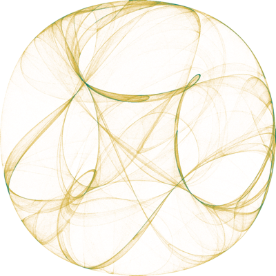

# ToyML: Machine Learning from Scratch

<p align="center">
  
</p>

<!-- --8<-- [start:overview] -->

[](https://pypi.org/project/toyml/)
[](https://pypi.org/project/toyml/)

[](https://github.com/ai-glimpse/toyml/actions/workflows/docs.yml)
[](https://github.com/ai-glimpse/toyml/actions/workflows/ci.yml)

[](https://github.com/astral-sh/ruff)
[](https://docs.astral.sh/ty/)
[](https://prek.j178.dev/)
[](https://zensical.org/)

There are machine learning algorithms implemented from scratch.
Let's learn machine learning with simple toy code.


## Models

- [x] Clustering: K-means
- [x] Clustering: DBSCAN
- [x] Clustering: Hierarchical (Bisecting K-means & AGNES)
- [x] Classification: KNN
- [x] Classification: Naive Bayes
- [x] Ensemble: AdaBoost
- [x] Ensemble: Isolation Forest


## Installation

Requires Python 3.11 or later. The core package has no runtime dependencies.

```bash
pip install toyml
```

For dendrograms and cluster-tree plots:

```bash
pip install "toyml[plot]"
```

## Development

Use uv for the locked environment and just for development commands:

```bash
just setup
just hooks
just check
```

See the [contributing guide](https://github.com/ai-glimpse/toyml/blob/master/CONTRIBUTING.md)
for individual lint, test, build, and Zensical preview commands.


## Release notes

See [GitHub Releases](https://github.com/ai-glimpse/toyml/releases) for version history and release notes.

<!-- --8<-- [end:overview] -->
